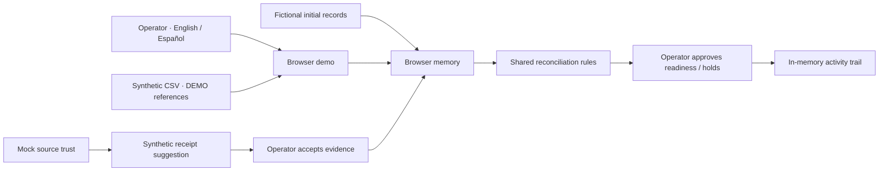
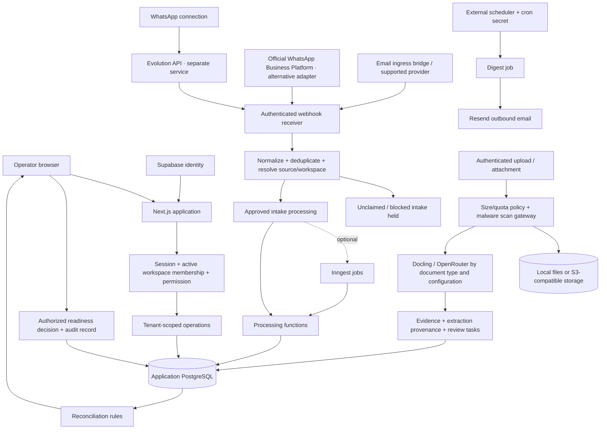

# Architecture

FleteOps is a Next.js/React application with TypeScript domain logic. The demo and connected source share the reconciliation engine, but their data paths differ. The engine checks requirements and discrepancies; a person makes the readiness decision.

## Default demo

`src/lib/demo/model.ts` owns the fixture state and transitions; `src/lib/demo/dictionaries.ts` owns localized labels; `src/app/demo/` renders the workflow. Reloading or resetting discards changes. There are no persistent sessions, real message transports, file uploads or AI calls in this path.

`src/lib/runtime-mode.ts` makes demo mode the default. The environment adapter ignores integration configuration in demo mode, while the request boundary rejects connected APIs and redirects application pages to the demo. The health route is available for process checks. It is not a database or integration connectivity test.

## Opt-in connected application

Arrows show code capabilities, not services provisioned by this repository. The browser demo does not activate this diagram. The email ingress bridge and malware gateway are external implementations; this repository contains their receiver/client contracts. PostgreSQL stores operational records; object storage holds document bytes. Supabase handles identity, while application tables control tenant membership and roles. They are separate responsibilities even if an operator chooses one vendor for both databases and auth.

Evolution API may have its own database, cache and session volumes. Those belong to the separately deployed service, not the FleteOps application database. Configure and back them up under that service's version-specific guidance. No Redis-backed application queue is required by the default demo. Inngest is optional in the connected code: without its event key, supported webhook handlers call processing functions inline. Email attachments are processed inline even when Inngest is configured.

Document routing chooses Docling for structured/digital documents and OpenRouter vision for photos or eligible fallbacks. Intake classification has a heuristic fallback when OpenRouter is not configured or fails. Extraction output is evidence to review, not authorization to pay or a guarantee of correctness. Connected processing can change operational state; validate every workflow with synthetic inputs before enabling real ingress.

## Trust boundaries to preserve

- Provider authentication proves webhook origin; it does not approve a sender, group, workspace or business fact.
- Active memberships and server-side permissions must gate tenant reads and writes. A browser-provided tenant identifier is not authorization.
- Unknown or blocked messaging sources stay outside automatic operational mutation until reviewed.
- Document size, quota and malware policy run before accepted evidence storage. Enable required scanning for untrusted connected intake; the default configuration permits scanning to be absent.
- Storage access uses application authorization and signed read URLs. Keep buckets private and scope credentials.
- AI providers receive content only through explicitly configured connected paths. Decide which data may leave your infrastructure before enabling them.

Source map: [environment](../src/lib/env.ts), [auth](../src/lib/auth/), [schema](../src/lib/db/schema/), [reconciliation](../src/lib/reconciliation/), [messaging sources](../src/lib/whatsapp/sources.ts), [documents](../src/lib/documents/), [webhooks](../src/app/api/webhooks/), [jobs](../src/inngest/).
